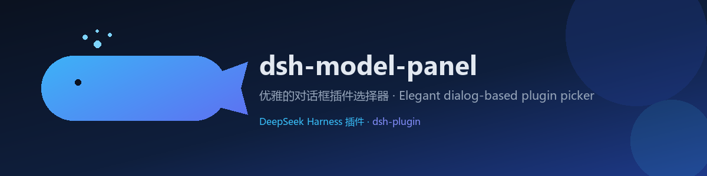
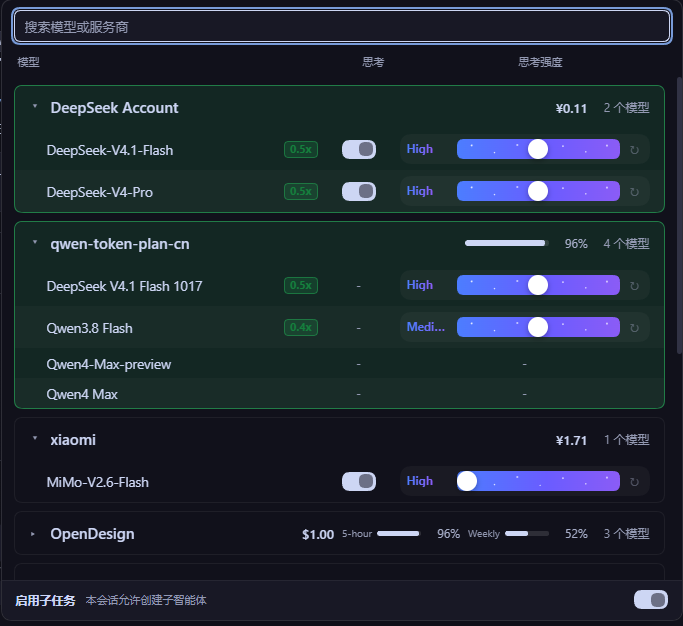

> [**中文**] | [English](./README_EN.md)

<div align="center">

# dsh-model-panel

<picture>
  <source srcset="assets/banner.svg" type="image/svg+xml">
  
</picture>

[](https://github.com/topics/dsh-plugin)
[](./LICENSE)
[](https://www.npmjs.com/package/dsh-model-panel)
[](./package.json)
[](https://github.com/topics/dsh-plugin)

**优雅的模型选择面板** —— 把输入框的模型选择位，换成一张可搜索的服务商 / 模型表格。

</div>

## 成果展示

<div align="center">



**表格面板主界面** — 搜索框 · 服务商分组树 · 余额/套餐/渠道积分 · 逐模型思考开关与力度滑条

</div>

| 界面元素 | 说明 |
| --- | --- |
| 顶部搜索框 | 实时过滤服务商与模型，Enter 选中首项 |
| 服务商表头 | 余额（¥9.75）、套餐进度（2%）、渠道积分与模型数同屏 |
| 模型行 | 思考开关 + 思考强度滑条（High 等档位）+ 一键重置 |

> 📷 截图统一放在 `images/` 目录，命名 `<场景>-<视图>.png`，浅色与深色主题各存一张。

## 功能特性

- **服务商分组树**：按 DSH 模型目录自身顺序排列，折叠状态记忆在 localStorage（`dsh-model-panel.collapsed`）；当所有分组都声明了数值排名（`order` / `seq` / `index` / `position` / `rank`）时按排名排序，部分排名会被忽略，列表永不错乱。
- **第三方渠道自动沉底**：由第三方渠道供能的服务商永远排在普通服务商之后。
- **即时搜索**：`Enter` 选中首个匹配项，方向键移动高亮。
- **聚焦展开**：没有折叠记忆时（首次使用）只展开当前模型所在的服务商，其余默认折叠；之后手动展开/折叠都会被记住，打开面板时仅自动展开当前模型所在的服务商。当前模型行用品牌色渐变高亮，一眼定位。
- **折扣倍率提示（按模型精确匹配，不按服务商）**：处于低价时段时，服务商表头变浅绿（**只变色，不显示任何倍率数字**，因为同一时段内各档折扣不同，表头写哪个都是错的），倍率只标在模型行上。
  - 匹配顺序：目录 id 精确相等 → 折叠键相等（小写、去分隔符、去 2–4 位尾号）→ 老缓存里的显示名 → 折叠前缀（`deepseek-v4.1-flash` 与 `deepseek-v4.1-flash-1017`）→ 整组无模型列表时套用整组。命中多个互斥档位时不显示，宁缺勿错。
  - 每档折扣有自己的时段：badge 自带 `22:00 - 次日 08:00` 之类的文案，不在窗内则当行不显示倍率。
  - DeepSeek 空闲时段：`0.5x`（工作日 12:00–14:00 / 18:00–20:00 之外）。
  - Qwen Token Plan 每晚 22:00–次日 08:00：Qwen3.8 系列 `0.4x`、DeepSeek-V4 系列 `0.5x`；`Auto` 归 0.4 档。目录 id 与 profile 模型 id 不同（`deepseek-v4.1-flash-1017` ↔ `DeepSeek-V4.1-Flash`）也会正确归组，未参与夜间活动的模型（如 `qwen4-max-preview` 的限时 2 折）不染色。
  - 小米 Token Plan 每日 00:00–08:00：`0.8x`（整组适用）。
- **逐模型思考开关与力度滑条**：同一行内固定宽度档位名、滑条与重置位，有无重置按钮滑条长度一致。
- **实时余额与套餐行**：显示在每个服务商表头右侧。
- **渠道积分同屏展示**：按渠道名合并去重，与余额、套餐并列显示。
- **启用子任务开关（下拉框最底一行）**：面板最后一行是本会话「启用子任务」开关，默认开启。关掉后宿主的委派工具（`subagent`、`subagent_oar`）在本会话及其所有子会话中直接拒绝，开关状态记在根会话上（子会话无法推翻父会话的决定），存放在宿主缓存目录的 `subagent-gate.json`，不写会话日志。门禁通过 `tools.guard` 安装且 fail-open：存储读不到、没有 agent、或非委派工具一律放行。
- **余额显示设置页**：`设置 → 插件 → 余额显示` 单独成页，保存 API 密钥读不到的用量凭据：
  - Qwen Token Plan：控制台 Cookie（原流程不变）。
  - OpenDesign：**控制键**（`vela_ctrl_…`，必填）、工作区 ID（可选，保存控制键时自动读取）、控制台 Cookie（可选备选）。OpenDesign 的运行时密钥（`sk-amr-…`）只能调用模型，读不到钱包与额度——实测其 `/api/v1/wallet/balance` 等全部 401，`/v1/chat/completions` 响应头也没有 quota 字段。
- **数据自读，链路干净**：浏览器端只请求一个接口 `GET /dsh-model-panel/state.json`，凭据只发往各适配器自身声明的地址，接口仅限回环访问并带跨站校验，缓存 60 秒、失败不报错。**首屏不等网络**：面板先用上一次的结果（浏览器 `localStorage` + 宿主 `last-state.json`）立即画出折扣与额度，宿主若回 `stale: true`，700 ms 后再取一次真数，冷启动不再空等整个采集。

> ⚠️ 由于作者的订阅与购买能力有限，个别服务商（尤其是需要控制台 Cookie 的用量接口）的余额 / 用量数字仍可能存在 bug。遇到这类显示问题欢迎直接提交 PR 修掉，或开 issue 附上接口返回。

## 安装方法

本插件是 DSH Cordis Bundle（Web 插件），任选其一：

**方式一：npm 安装（推荐）**

1. 在 web profile 目录执行：

   ```bash
   npm install dsh-model-panel
   ```

   （包地址：[npmjs.com/package/dsh-model-panel](https://www.npmjs.com/package/dsh-model-panel)）

2. 在该 profile 的 `package.json` 里登记 bundle：

   ```json
   "dsh": { "profile": { "bundles": ["dsh-model-panel"] } }
   ```

3. 重启 Harness 后生效；升级只需 `npm update dsh-model-panel` 再重启。

**方式二：插件管理器**

1. 打开 Harness UI 的插件管理器：`plugin_manager → install_bundle`
2. `target` 填入本仓库目录的绝对路径
3. 首次安装可通过 HMR 直接激活；替换已安装副本需重启 Harness 加载新的 JS 模块代。

**方式三：手动写入 web profile**

1. 在 web profile 的 `package.json` 的 `dependencies` 中添加本包：

   ```json
   "dsh-model-panel": "file:C:/path/to/dsh-model-panel"
   ```

2. 在同一个 `package.json` 的 `dsh.profile.bundles` 数组里登记包名（bundle 自带的 patch 会随之展开，不需要手写 `cordis.patch.yml`）：

   ```json
   "dsh": {
     "profile": {
       "bundles": ["dsh-model-panel"]
     }
   }
   ```

3. 重启 Harness 后生效。

## 使用方法

安装后，输入框原有的模型选择位被替换为表格面板：

- **搜索**：直接输入文字过滤服务商与模型，`Enter` 选中第一个匹配项，↑/↓ 移动高亮。
- **折叠/展开**：点击服务商表头切换分组，状态自动记忆，下次打开保持一致。
- **思考开关**：每个模型行内可单独开关思考（`dsh-model-panel.off`）。
- **力度滑条**：调节 reasoning effort（`dsh-model-panel.efforts`），`重置` 恢复默认。
- **余额 / 套餐 / 渠道积分**：显示在服务商表头右侧；渠道未配置账号时显示「剩余 0」，查询失败时显示「查询失败」。

### 余额显示（额外凭据）

有些用量只存在于已登录的控制台或需要控制键，API 密钥读不到，于是单独开了一页。每一行都是「点开 → 粘贴 → 保存并测试 → 立即回读」，保存后立刻显示套餐名、进度条、周期结束时间；失效会直接提示重新粘贴，「清除」会把它从本机凭据库删掉。OpenDesign 的「控制键」这一行会连同同组的工作区 ID、Cookie 一起送去探测，直接在卡片上显示钱包余额与 5 小时 / 7 天窗口，所以点完「浏览器登录」当场就能看出有没有生效。

| 服务商 | 凭据 | 必填 | 读到的内容 |
| --- | --- | --- | --- |
| Qwen Token Plan | 控制台 Cookie：直接粘贴 Cookie 头，或 Cookie-Editor「Export As: JSON」的整段内容 | 是 | 套餐档位、月度用量百分比、周期结束时间 |
| MiMo Token Plan | 同上（粘贴口径完全一致） | 是 | 钱包余额、计划总量 / 本月用量、周期结束时间 |
| OpenDesign | 控制键 `vela_ctrl_…`（可在面板里点「浏览器登录」自动获取） | 是 | 钱包余额（USD）、Coding Plan 的 5 小时 / 7 天窗口用量 |
| OpenDesign | 工作区 ID | 否 | 不填则用 `/api/v1/workspaces/current` 自动发现；保存控制键时会自动回填 |
| OpenDesign | 控制台 Cookie | 否 | 控制键缺失时的备选认证方式 |

OpenDesign 的**运行时密钥**（`sk-amr-…`，用来调用模型的那个）读不到任何额度：实测 `amr-api.open-design.ai/api/v1/wallet/balance`、`billing/summary`、`workspaces/current` 全部 401，模型域 `amr-link.open-design.ai/v1/chat/completions` 的响应头也没有 quota 字段。所以必须单独配控制键，两者分开保存。

**控制键不用去网页上找。** 官方把它放在 CLI 设备授权流程里（`vela login`）：面板里那一栏点「浏览器登录」，插件向 `amr-api.open-design.ai/api/v1/cli/device-authorizations` 申请一枚 6 位码，自动打开 `open-design.ai/cloud/cli/activate`，你输入码并批准，页面每 2 秒轮询一次，批准瞬间控制键就写进本机凭据库、工作区 ID 一并回填。120 秒没批准就过期，点「重新发起」再来一次；中途关页面不影响，只要批准了下次轮询仍会拿到。控制键仍可手动粘贴保存。

**不必从控制台手抄 Cookie，也不用导出文件。** 在 Cookie-Editor 里点「Export As: JSON」，把整段 JSON 原样粘进输入框即可（直接粘 `name=value; name2=value2` 也照旧可用）。保存时自动转成请求头：原生 JSON 数组、`{"cookies":[…]}` / `{"data":[…]}` 包裹、Netscape `cookies.txt`（含 `#HttpOnly_` 前缀）、纯 `{name: value}` 映射都认。

`domain` 落在该服务商域名后缀下的优先（Qwen 认 `qianwenai.com` / `aliyun.com` / `aliyuncs.com`，MiMo 认 `xiaomimimo.com` / `mi.com`，OpenDesign 认 `open-design.ai`）；一条都对不上时整段照用 —— 多带几个 cookie 网关会忽略，空请求头才是静默失败。空值、超期（`expirationDate` 早于当前时间且非会话 cookie）和含 `;` 或换行的值会被丢掉，同名 cookie 以后出现的为准。导入后提示「已导入 N 条 Cookie」，被滤掉的条数会一并说明。

所有需要 cookie 的模块都走这一套：Qwen Token Plan、MiMo Token Plan 以及 OpenDesign 的备用控制台 Cookie，粘贴口径完全一致。

凭据只写入本机 DSH 凭据库，不写入插件配置、日志或浏览器存储，也不会回显。未实测成功的协议不会出现在该页。

## 配置说明

| 项 | 说明 |
| --- | --- |
| 依赖服务 | `conversation.input.model` 模型位及各插槽（`dsh-client-ui-slots`、`dsh-client-locale`、`dsh-client-ui-model-selection`、`dsh-api-session-controller`），宿主需提供可注册精确路由的 `webServer` |
| 可选集成 | `dsh-connect`（WorkBuddy / Trae / Qoder 渠道积分）、Our Free Model（EAC 路由积分）——不安装不影响面板渲染 |
| 数据接口 | `GET /dsh-model-panel/state.json`，仅回环、带跨站校验、缓存 60 秒 |
| 设置页接口 | `GET /dsh-model-panel/settings.json`（已存凭据与其解锁的用量）、`POST /dsh-model-panel/secret.json`（`{id, ref, action:'save'|'clear', value}`；`ref` 省略时按 `id` 定位），同样仅回环 |
| 凭据名 | `QWEN_TOKEN_PLAN_COOKIE`（Qwen 控制台会话）、`OPENDESIGN_CONTROL_KEY`（控制键）、`OPENDESIGN_WORKSPACE_ID`（工作区）、`OPENDESIGN_CONSOLE_COOKIE`（控制台 Cookie） |
| 本地存储 | `dsh-model-panel.collapsed`（折叠状态）、`dsh-model-panel.off`（思考开关）、`dsh-model-panel.efforts`（力度） |
| 客户端结构 | `client.js` 是入口，按需加载四个 chunk：`client.shared.js`（词典 / 存储 / 格式化 / 控件）、`client.panel.js`（模型面板）、`client.settings.js`（设置页与座位降级边界）、`client.css.js`（样式）。样式由入口一次性挂到 `<head>`，不参与每次渲染的 vdom 比对 |

**开发自检**：

```bash
npm run check   # 宿主半端 + 入口与四个 chunk 的 node --check
npm test        # test/run.mjs，无依赖、无网络
```

## 许可证

MIT © poloniumn — 详见 [LICENSE](./LICENSE)。

---

欢迎通过 [dsh-plugin 话题](https://github.com/topics/dsh-plugin) 发现更多 DeepSeek Harness 插件。
