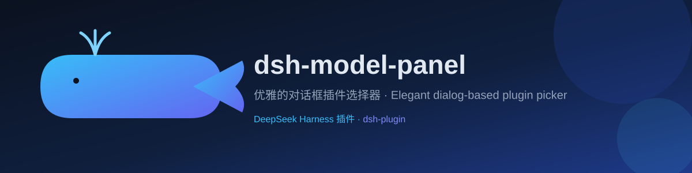

> [**中文**] | [English](./README_EN.md)

<div align="center">

# dsh-model-panel



[](https://github.com/topics/dsh-plugin)
[](./LICENSE)
[](./package.json)
[](https://github.com/topics/dsh-plugin)

**优雅的对话框插件选择器** —— 把输入框的模型选择位，换成一张可搜索的服务商/模型表格。

</div>

## 功能特性

- **服务商分组树**：按 DSH 模型目录自身顺序排列，折叠状态记忆在 localStorage（`dsh-model-panel.collapsed`）；当所有分组都声明了数值排名（`order` / `seq` / `index` / `position` / `rank`）时按排名排序，部分排名会被忽略，列表永不错乱。
- **第三方渠道自动沉底**：由第三方渠道供能的服务商永远排在普通服务商之后。
- **即时搜索**：`Enter` 选中首个匹配项，方向键移动高亮。
- **逐模型思考开关与力度滑条**：同一行内固定宽度档位名、滑条与重置位，有无重置按钮滑条长度一致。
- **实时余额与套餐行**：显示在每个服务商表头右侧。
- **渠道积分同屏展示**：按渠道名合并去重，与余额、套餐并列显示。
- **数据自读，链路干净**：浏览器端只请求一个接口 `GET /dsh-model-panel/state.json`，凭据只发往各适配器自身声明的地址，接口仅限回环访问并带跨站校验，缓存 60 秒、失败不报错。

## 安装方法

本插件是 DSH Cordis Bundle（Web 插件），任选其一：

**方式一：插件管理器（推荐）**

1. 打开 Harness UI 的插件管理器：`plugin_manager → install_bundle`
2. `target` 填入本仓库目录的绝对路径
3. 首次安装可通过 HMR 直接激活；替换已安装副本需重启 Harness 加载新的 JS 模块代。

**方式二：手动写入 web profile**

1. 在 web profile 的 `package.json` 的 `dependencies` 中添加本包：

   ```json
   "dsh-model-panel": "file:C:/path/to/dsh-model-panel"
   ```

2. 在 `cordis.patch.yml` 的 `insert` 列表中加入对应条目（即本插件自带的 patch）：

   ```yaml
   - insert:
       - id: dsh-model-panel
         name: dsh-model-panel
   ```

3. 重启 Harness 后生效。

## 使用方法

安装后，输入框原有的模型选择位被替换为表格面板：

- **搜索**：直接输入文字过滤服务商与模型，`Enter` 选中第一个匹配项，↑/↓ 移动高亮。
- **折叠/展开**：点击服务商表头切换分组，状态自动记忆，下次打开保持一致。
- **思考开关**：每个模型行内可单独开关思考（`dsh-model-panel.off`）。
- **力度滑条**：调节 reasoning effort（`dsh-model-panel.efforts`），`重置` 恢复默认。
- **余额 / 套餐 / 渠道积分**：显示在服务商表头右侧；渠道未配置账号时显示「剩余 0」，查询失败时显示「查询失败」。

## 配置说明

| 项 | 说明 |
| --- | --- |
| 依赖服务 | `conversation.input.model` 模型位及各插槽（`dsh-client-ui-slots`、`dsh-client-locale`、`dsh-client-ui-model-selection`、`dsh-api-session-controller`），宿主需提供可注册精确路由的 `webServer` |
| 可选集成 | `dsh-connect`（WorkBuddy / Trae / Qoder 渠道积分）、Our Free Model（EAC 路由积分）——不安装不影响面板渲染 |
| 数据接口 | `GET /dsh-model-panel/state.json`，仅回环、带跨站校验、缓存 60 秒 |
| 本地存储 | `dsh-model-panel.collapsed`（折叠状态）、`dsh-model-panel.off`（思考开关）、`dsh-model-panel.efforts`（力度） |

**开发自检**：

```bash
npm run check   # 两个半端的 node --check
npm test        # test/run.mjs，无依赖、无网络
```

## 成果展示

> 📷 截图占位区：把截图放入本会话工作区（`images/` 目录，png/jpg）后告诉我，我会按网格布局排进这里。

## 许可证

MIT © poloniumn — 详见 [LICENSE](./LICENSE)。

---

欢迎通过 [dsh-plugin 话题](https://github.com/topics/dsh-plugin) 发现更多 DeepSeek Harness 插件。
