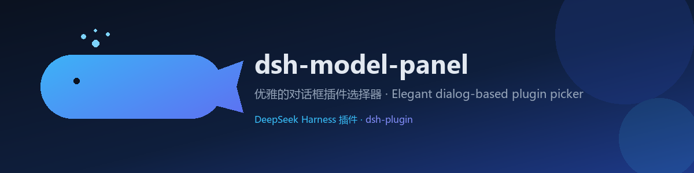
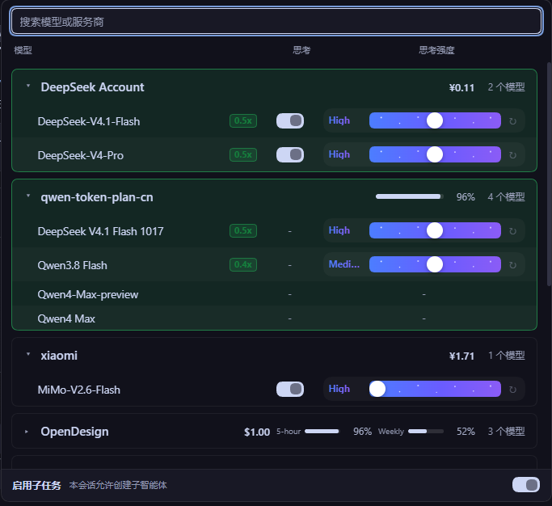

> [中文](./README.md) | [**English**]

<div align="center">

# dsh-model-panel

<picture>
  <source srcset="assets/banner.svg" type="image/svg+xml">
  
</picture>

[](https://github.com/topics/dsh-plugin)
[](./LICENSE)
[](https://www.npmjs.com/package/dsh-model-panel)
[](./package.json)
[](https://github.com/topics/dsh-plugin)

**An elegant model panel** — it replaces the composer's model seat with a searchable provider / model table.

</div>

## Screenshots

<div align="center">



**The table panel** — search box · provider tree · per-model discount chips (`0.5x` / `0.4x`) · balance / plan / channel credits · thinking toggle and effort slider · the subagent switch

</div>

| UI element | What it does |
| --- | --- |
| Search box | Filters providers and models live; Enter picks the first match |
| Provider header | Balance (`¥0.11`), plan progress (`96%`), and the OpenDesign wallet at `$1.00` with its 5-hour / Weekly windows on one line |
| Model row | Thinking toggle + effort slider (High etc.) + one-click reset |
| Discount chip | Drawn on model rows only (`0.5x` / `0.4x`); outside the window the row stays unmarked, and the header only turns green without a number |
| Last row | The per-session 启用子任务 switch; off means `subagent` / `subagent_oar` refuse in this session |

## Features

- **Provider tree**: drawn in the model directory's own order, with third-party-fed providers always last; collapse state is remembered in localStorage (`dsh-model-panel.collapsed`), and with no saved state only the current model's provider starts expanded. The selected row gets a brand-colour gradient.
- **Live search**: filters providers and models as you type; `Enter` picks the first match and ↑/↓ move the highlight.
- **Discount chips on model rows only**: inside a low-price window the provider header turns soft green and shows **no number at all** (one window can hold several rates), while the multiplier is drawn per model — catalog id → folded key → display name → folded prefix, and nothing is drawn when two conflicting groups match. DeepSeek off-peak `0.5x` (outside weekday 12:00–14:00 and 18:00–20:00); Qwen Token Plan 22:00–08:00 gives Qwen3.8 models `0.4x` and DeepSeek-V4 models `0.5x`; MiMo Token Plan 00:00–08:00 gives the whole group `0.8x`.
- **Per-model thinking toggle and effort slider**: one line with a fixed-width level name, the slider and a reset slot.
- **Balance, plan and channel credits together**: in each provider header's right cluster, channel credits merged by channel name.
- **A per-session subagent switch on the dropdown's last row**: on by default; switching it off makes the host's `subagent` / `subagent_oar` refuse in this session and every child of it. The decision is keyed by the root session, lives in `subagent-gate.json` in the host cache directory, and the gate fails open.
- **Balance settings tab**: `Settings → Plugins → Balance display` stores the credentials API keys cannot replace (Qwen / MiMo console cookies, and OpenDesign's `vela_ctrl_…` control key with an optional workspace id and cookie).
- **Self-read data path**: the browser half requests exactly one endpoint, `GET /dsh-model-panel/state.json`; credentials only go to the URL each adapter declares, the route is loopback-only with cross-site checks, cached 60 s, and never rejects. **The first paint never waits for the network** — the previous answer (`localStorage` plus the host's `last-state.json`) is drawn immediately, and a `stale: true` reply is followed 700 ms later by the fresh numbers.

## Installation

This package is a DSH Cordis bundle (Web plugin). Either path works:

**Option A — npm (recommended)**

1. Inside the web profile directory:

   ```bash
   npm install dsh-model-panel
   ```

2. Register the bundle in that profile's `package.json`:

   ```json
   "dsh": { "profile": { "bundles": ["dsh-model-panel"] } }
   ```

3. Restart the Harness. To upgrade later: `npm update dsh-model-panel`, then restart.

**Option B — Plugin Manager**

1. Open `plugin_manager → install_bundle` in the Harness UI.
2. Set `target` to the absolute path of this repository directory.
3. A first install can activate through HMR; replacing an already installed copy needs a Harness restart to load a fresh JavaScript module generation.

**Option C — Write it into the web profile manually**

1. Add the package to the web profile's `package.json` under `dependencies`:

   ```json
   "dsh-model-panel": "file:C:/path/to/dsh-model-panel"
   ```

2. Register the package name in that same `package.json` under `dsh.profile.bundles` — the bundle's own patch is expanded from there, so no hand-written `cordis.patch.yml` entry is needed:

   ```json
   "dsh": {
     "profile": {
       "bundles": ["dsh-model-panel"]
     }
   }
   ```

3. Restart the Harness to activate it.

## Usage

Once installed, the composer's original model seat is replaced by the table panel:

- **Usage**: type to filter providers and models; `Enter` selects the first match and ↑/↓ moves the highlight. Clicking a provider header collapses it, the thinking toggle and effort slider act per model (`dsh-model-panel.off` / `.efforts`), and a channel with no configured account shows a zero balance.

### Balance display (extra credentials)

Some usage only exists behind a logged-in console or behind a control key, and API keys cannot read it, so it gets a page of its own: open the row, paste, **Save and test**, and the usage is read back at once. An expired credential says so and asks for a new one; **Clear** removes it from the local credential store. OpenDesign's **runtime key** (`sk-amr-…`, the one used for inference) reads no allowance at all — its `/api/v1/wallet/balance` and friends answer 401 — so a control key is stored separately; the row's "Sign in with a browser" button mints one through the CLI device flow (a 6-character code at `open-design.ai/cloud/cli/activate`, 120 s to approve, and the key plus workspace id are written on approval).

Every cookie-based module takes the same paste: the plain `name=value; …` header, or the whole Cookie-Editor *Export As: JSON* text (native array, `{"cookies":[…]}` / `{"data":[…]}` wrapper, Netscape `cookies.txt`, plain `{name: value}` map). Cookies under the provider's own `domain` suffixes win; when none matches, the whole paste is used. Empty, expired and `;`-bearing values are dropped. Credentials go to the local DSH credential store only — never to the plugin config, logs or browser storage.

| Provider | Credential | Required | What it reads |
| --- | --- | --- | --- |
| Qwen Token Plan | console cookie: paste the header, or the whole Cookie-Editor *Export As: JSON* text | yes | plan tier, monthly usage percentage, period end |
| MiMo Token Plan | the same paste, identical wording | yes | wallet balance, plan total and month-to-date usage, period end |
| OpenDesign | control key `vela_ctrl_…` (the panel can mint one via "Sign in with a browser") | yes | wallet balance in USD, the Coding Plan 5-hour and 7-day windows — read on this row itself, together with the workspace id and cookie beside it |
| OpenDesign | workspace id | no | omitted, it is discovered from `/api/v1/workspaces/current`; a control key save fills it in |
| OpenDesign | console cookie | no | fallback authentication when there is no control key |

## Configuration

| Item | Details |
| --- | --- |
| Requirements | the `conversation.input.model` seat and its slots (`dsh-client-ui-slots`, `dsh-client-locale`, `dsh-client-ui-model-selection`, `dsh-api-session-controller`); the host must expose a `webServer` able to register an exact route |
| Optional integrations | `dsh-connect` (WorkBuddy / Trae / Qoder channel credits), Our Free Model (EAC router credits) — neither is required; a missing source contributes nothing |
| Data endpoint | `GET /dsh-model-panel/state.json` — loopback-only, cross-site checked, 60 s cache |
| Settings endpoints | `GET /dsh-model-panel/settings.json` (stored credentials and the usage they unlock), `POST /dsh-model-panel/secret.json` (`{id, ref, action:'save'|'clear', value}`; `ref` is resolved from `id` when omitted) — loopback-only as well |
| Secret names | `QWEN_TOKEN_PLAN_COOKIE` (Qwen console session), `OPENDESIGN_CONTROL_KEY` (control key), `OPENDESIGN_WORKSPACE_ID` (workspace), `OPENDESIGN_CONSOLE_COOKIE` (console cookie) |
| Local storage | `dsh-model-panel.collapsed` (collapse state), `dsh-model-panel.off` (thinking toggle), `dsh-model-panel.efforts` (effort level) |
| Client layout | `client.js` is the entry and loads four chunks on demand: `client.shared.js` (dictionary / storage / formatting / controls), `client.panel.js` (the model panel), `client.settings.js` (settings tab and seat boundary), `client.css.js` (styles). Styles are mounted into `<head>` once, so they never take part in per-render vdom diffs |

**Development self-checks**:

```bash
npm run check   # node --check on the host half plus the entry and its four chunks
npm test        # test/run.mjs — no dependencies, no network
```

## License

MIT © poloniumn — see [LICENSE](./LICENSE).

---

Discover more DeepSeek Harness plugins through the [dsh-plugin topic](https://github.com/topics/dsh-plugin).
