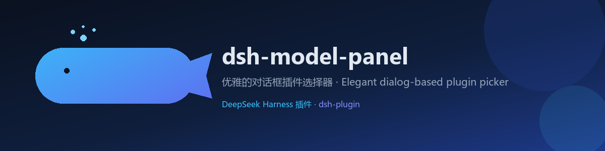
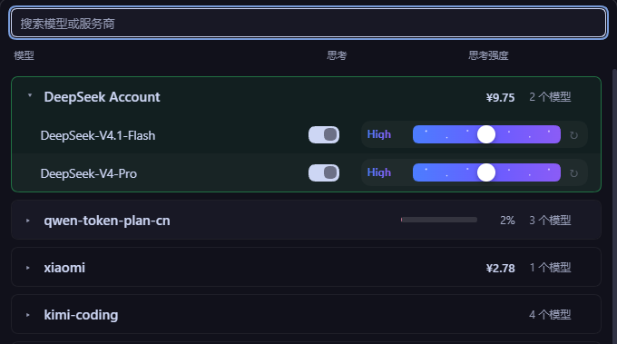

> [中文](./README.md) | [**English**]

<div align="center">

# dsh-model-panel

<picture>
  <source srcset="assets/banner.svg" type="image/svg+xml">
  
</picture>

[](https://github.com/topics/dsh-plugin)
[](./LICENSE)
[](https://www.npmjs.com/package/dsh-model-panel)
[](./package.json)
[](https://github.com/topics/dsh-plugin)

**An elegant model panel** — it replaces the composer's model seat with a searchable provider / model table.

</div>

## Screenshots

<div align="center">



**The table panel** — search box · provider tree · balance / plan / channel credits · per-model thinking toggle and effort slider

</div>

| UI element | What it does |
| --- | --- |
| Search box | Filters providers and models live; Enter picks the first match |
| Provider header | Balance (¥9.75), plan progress (2%), channel credits and model count on one line |
| Model row | Thinking toggle + effort slider (High etc.) + one-click reset |

> 📷 Screenshots live in `images/`, named `<scene>-<view>.png` — one light theme, one dark.

## Features

- **Provider tree**: drawn in the model directory's own order, with collapse state remembered in localStorage (`dsh-model-panel.collapsed`). When every group declares a numeric rank (`order` / `seq` / `index` / `position` / `rank`) that rank is honoured; a partial rank list is ignored so the list is never half-reshuffled.
- **Third-party channels sink to the bottom**: a provider fed by a third-party channel is always drawn after the plain ones.
- **Focus on open**: each time the panel opens only the provider holding the current model stays expanded, the rest fold away, and the selected model row is highlighted with a brand-colour gradient.
- **Discount multiplier**: while a low-price window is active the provider header turns soft green and the model name gains a multiplier chip — DeepSeek off-peak `0.5x`, Qwen Token Plan `0.4x` from 22:00 to 08:00 Beijing time, MiMo Token Plan `0.8x` from 00:00 to 08:00.
- **Per-model thinking toggle & effort slider**: one line with a fixed-width level name, the slider, and a reset slot that keeps the slider the same length with or without the button.
- **Live balance & plan rows** in each provider's header.
- **Channel credits side by side**, merged by channel name.
- **Balance settings tab**: `Settings → Plugins → Balance display` is its own page. It stores only a console cookie and shows usage that API keys cannot reach (Qwen Token Plan today), without ever sending a key request.
- **Self-read data path**: the browser half requests exactly one endpoint, `GET /dsh-model-panel/state.json`; credentials only ever go to the URL each adapter declares, the route is loopback-only with cross-site checks, cached for 60 s, and never rejects.

> ⚠️ The author can only subscribe to a limited set of providers. Balance / usage figures for some of them — console-cookie endpoints in particular — may still be wrong. If you hit a display bug like that, a PR is very welcome, or open an issue with the raw response.

## Installation

This package is a DSH Cordis bundle (Web plugin). Either path works:

**Option A — npm (recommended)**

1. Inside the web profile directory:

   ```bash
   npm install dsh-model-panel
   ```

   (Package page: [npmjs.com/package/dsh-model-panel](https://www.npmjs.com/package/dsh-model-panel))

2. Register the bundle in that profile's `package.json`:

   ```json
   "dsh": { "profile": { "bundles": ["dsh-model-panel"] } }
   ```

3. Restart the Harness. To upgrade later: `npm update dsh-model-panel`, then restart.

**Option B — Plugin Manager**

1. Open `plugin_manager → install_bundle` in the Harness UI.
2. Set `target` to the absolute path of this repository directory.
3. A first install can activate through HMR; replacing an already installed copy needs a Harness restart to load a fresh JavaScript module generation.

**Option C — Write it into the web profile manually**

1. Add the package to the web profile's `package.json` under `dependencies`:

   ```json
   "dsh-model-panel": "file:C:/path/to/dsh-model-panel"
   ```

2. Register the package name in that same `package.json` under `dsh.profile.bundles` — the bundle's own patch is expanded from there, so no hand-written `cordis.patch.yml` entry is needed:

   ```json
   "dsh": {
     "profile": {
       "bundles": ["dsh-model-panel"]
     }
   }
   ```

3. Restart the Harness to activate it.

## Usage

Once installed, the composer's original model seat is replaced by the table panel:

- **Search**: type to filter providers and models; `Enter` selects the first match, ↑/↓ moves the highlight.
- **Collapse / expand**: click a provider header; the state is remembered between sessions.
- **Thinking toggle**: enable or disable thinking per model (`dsh-model-panel.off`).
- **Effort slider**: adjust reasoning effort (`dsh-model-panel.efforts`); the reset slot restores the default.
- **Balance / plan / channel credits** appear in the provider header's right cluster; a channel with no configured account shows a zero balance, and a failed lookup shows a query failure instead of hiding the row.

### Balance display (cookie usage)

Some usage only exists behind a logged-in console and API keys cannot read it, so it gets a page of its own:

1. Open `Settings → Plugins → Balance display`.
2. Click **Set cookie** and paste the whole cookie header from a console request (`name=value; name2=value2`), then click **Save and test**.
3. The usage is read back immediately: plan name, a used-percentage bar and the period end date. An expired cookie says so and asks you to paste a new one.
4. **Clear** deletes that cookie from the local credential store.

The cookie is written to the local DSH credential store only — never to the plugin config, logs or browser storage, and it is never echoed back. Only verified providers are listed (Qwen Token Plan for now); providers whose cookie protocol is still being measured stay hidden.

## Configuration

| Item | Details |
| --- | --- |
| Requirements | the `conversation.input.model` seat and its slots (`dsh-client-ui-slots`, `dsh-client-locale`, `dsh-client-ui-model-selection`, `dsh-api-session-controller`); the host must expose a `webServer` able to register an exact route |
| Optional integrations | `dsh-connect` (WorkBuddy / Trae / Qoder channel credits), Our Free Model (EAC router credits) — neither is required; a missing source contributes nothing |
| Data endpoint | `GET /dsh-model-panel/state.json` — loopback-only, cross-site checked, 60 s cache |
| Settings endpoints | `GET /dsh-model-panel/settings.json` (stored cookies and the usage they unlock), `POST /dsh-model-panel/secret.json` (`{id, action:'save'|'clear', value}`) — loopback-only as well |
| Cookie secret name | `QWEN_TOKEN_PLAN_COOKIE` (Qwen Token Plan console session) |
| Local storage | `dsh-model-panel.collapsed` (collapse state), `dsh-model-panel.off` (thinking toggle), `dsh-model-panel.efforts` (effort level) |

**Development self-checks**:

```bash
npm run check   # node --check on both halves
npm test        # test/run.mjs — no dependencies, no network
```

## License

MIT © poloniumn — see [LICENSE](./LICENSE).

---

Discover more DeepSeek Harness plugins through the [dsh-plugin topic](https://github.com/topics/dsh-plugin).
